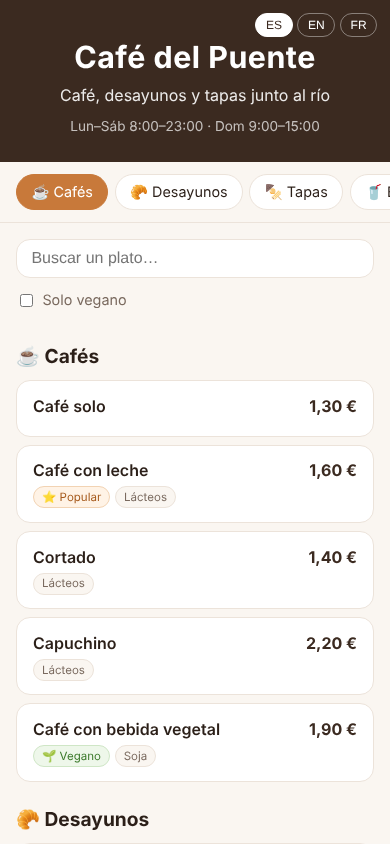
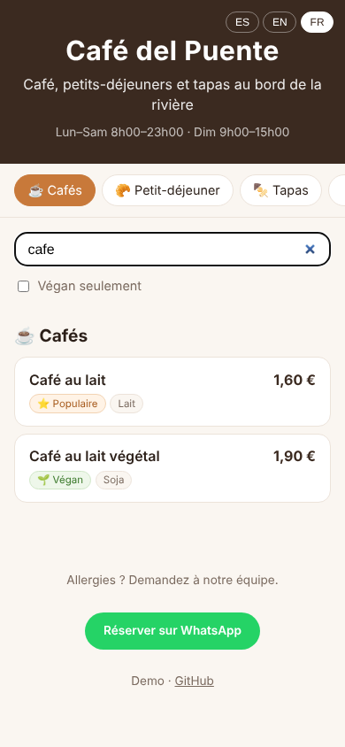

# ☕ Menú QR para cafeterías — Menu QR pour cafés

Un menú digital para bares y cafeterías. El cliente escanea un código QR en la mesa y ve la carta en su móvil, en **español, inglés o francés**.

Un menu numérique pour bars et cafés. Le client scanne un QR code sur la table et voit la carte sur son téléphone, en **espagnol, anglais ou français**.

**👉 Demo : https://elalamiz605-tech.github.io/menu-qr-cafe/**

<p>
  
  
  
</p>

## Funciones · Fonctions

- 🌍 3 idiomas (ES / EN / FR), elige solo el idioma del móvil
- 🔎 Buscador de platos
- 🌱 Filtro vegano
- ⚠️ Alérgenos en cada plato
- 📱 Pensado para móvil, carga muy rápido
- 💬 Botón de WhatsApp para reservar
- 🖨️ Se puede imprimir

## Cambiar la carta · Modifier la carte

Todo está en **un solo archivo: `menu.json`**. No hace falta saber programar.
Tout est dans **un seul fichier : `menu.json`**. Pas besoin de savoir coder.

```json
{ "name": { "es": "Café con leche", "en": "Coffee with milk", "fr": "Café au lait" },
  "price": 1.60, "allergens": ["milk"], "tags": ["popular"] }
```

- `allergens` : `gluten`, `milk`, `egg`, `soy`, `sulphites`
- `tags` : `popular`, `vegan`, `spicy`

## Tecnología · Technologie

HTML, CSS y JavaScript puro. Sin frameworks, sin servidor. Alojado gratis en GitHub Pages.

Probar en local · Tester en local :

```bash
python3 -m http.server 8000
# abrir http://localhost:8000
```

## Autor · Auteur

Hecho en Salamanca por **elalamiz605-tech** — servicios digitales para pequeños comercios.
¿Quieres este menú para tu negocio? Contáctame.

> *Café del Puente* es un negocio ficticio para la demo.
