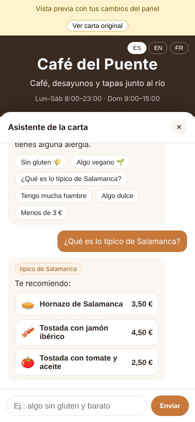
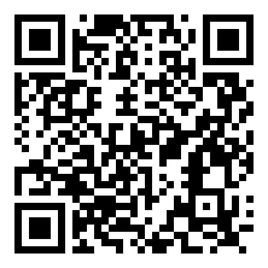

# ☕ Menú QR para cafeterías — Menu QR pour cafés

Un menú digital para bares y cafeterías. El cliente escanea un código QR en la mesa y ve la carta en su móvil, en **español, inglés o francés**.

Un menu numérique pour bars et cafés. Le client scanne un QR code sur la table et voit la carte sur son téléphone, en **espagnol, anglais ou français**.

| | |
|---|---|
| 📱 **Carta demo** | https://elalamiz605-tech.github.io/menu-qr-cafe/ |
| 💼 **Página del servicio** | https://elalamiz605-tech.github.io/menu-qr-cafe/servicio.html |
| ✏️ **Panel del negocio** | https://elalamiz605-tech.github.io/menu-qr-cafe/admin.html |

<p>
  
  
  
</p>

## Funciones · Fonctions

- ✨ **Asistente «¿Qué pido?»**: el cliente escribe «sin gluten», «algo típico» o «menos de 3 €» y recibe recomendaciones (ES / EN / FR, sin servidor)
- ✏️ **Panel del negocio**: cambiar platos, precios y fotos sin código
- 📊 **Google Sheets**: el dueño edita una hoja y la carta se actualiza para todos
- 📷 Fotos de los platos (o ilustración si no hay foto)
- 🌍 3 idiomas (ES / EN / FR), elige solo el idioma del móvil
- ⚠️ Los 14 alérgenos de la normativa europea
- 🔎 Buscador de platos y filtro vegano
- 📱 Pensado para móvil, carga muy rápido
- 💬 Botón de WhatsApp para reservar
- 🖨️ Se puede imprimir

## Cambiar la carta · Modifier la carte

Tres maneras · Trois façons :

1. **Panel** (`admin.html`): modo demo, guarda en el navegador y exporta `menu.json`.
2. **Google Sheets**: descarga la plantilla desde el panel, publícala en CSV y pega el enlace en `"sheetCsvUrl"` dentro de `menu.json`.
3. **A mano**: editar `menu.json`.

```json
{ "name": { "es": "Café con leche", "en": "Coffee with milk", "fr": "Café au lait" },
  "price": 1.60, "allergens": ["milk"], "tags": ["popular"] }
```

- `allergens` : `gluten`, `crustaceans`, `egg`, `fish`, `peanuts`, `soy`, `milk`, `nuts`, `celery`, `mustard`, `sesame`, `sulphites`, `lupin`, `molluscs`
- `tags` : `popular`, `vegan`, `spicy`, `sweet`, `hearty`, `light`, `local`

## Tecnología · Technologie

HTML, CSS y JavaScript puro. Sin frameworks, sin servidor. Alojado gratis en GitHub Pages.

Probar en local · Tester en local :

```bash
python3 -m http.server 8000
# abrir http://localhost:8000
```

## Autor · Auteur

Hecho por **elalamiz605-tech** — servicios digitales para pequeños comercios.
¿Quieres este menú para tu negocio? Contáctame.

> *Café del Puente* es un negocio ficticio para la demo.
